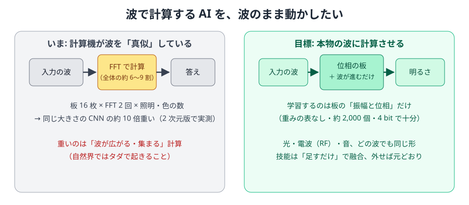
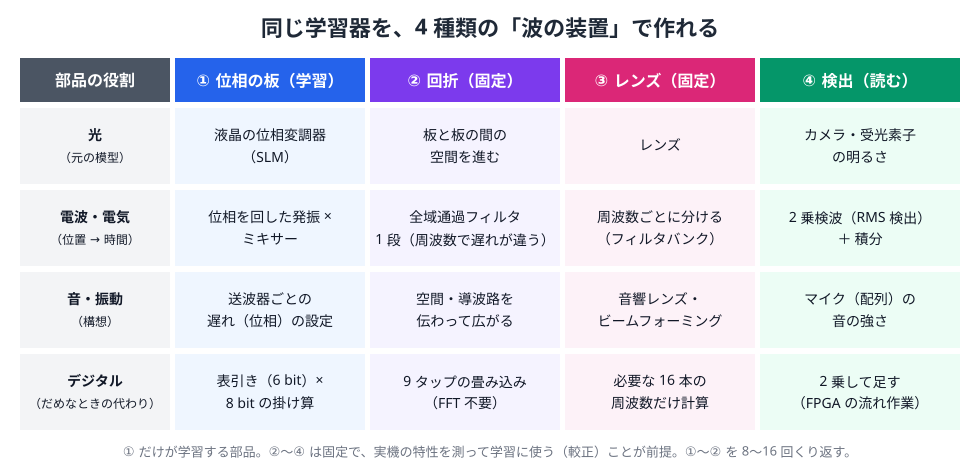
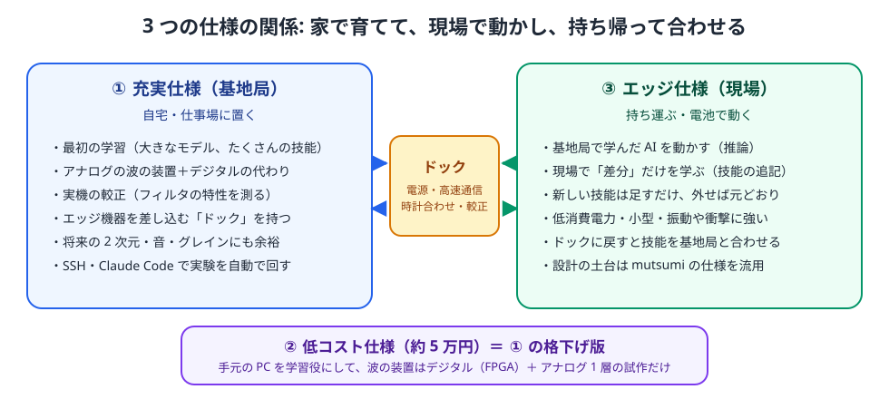
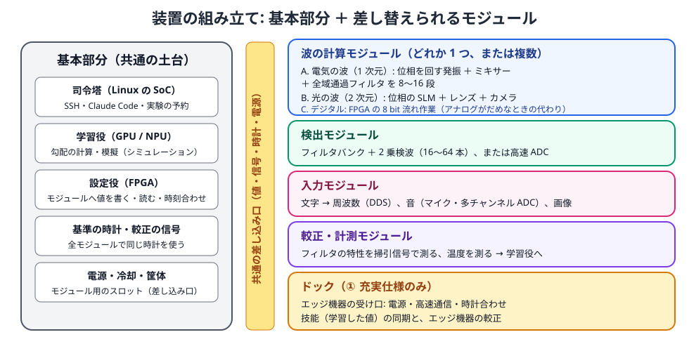
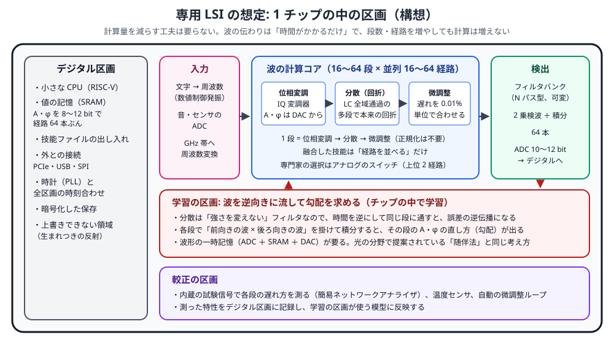
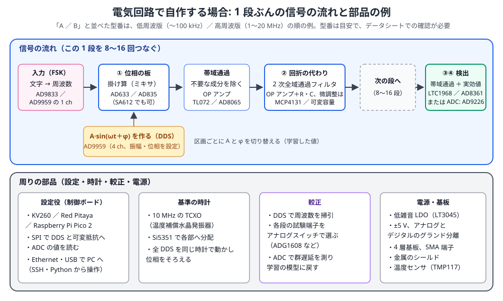

# 波で計算する AI のための「欲しい専用機」— 3 つの仕様（構想）

> この文書は、Sin-CNN 系の AI（正弦波の干渉と回折だけで計算する AI）を、**本物の波**（電気・光・音）で動かす専用機の「欲しい仕様」をまとめた構想メモです。
> LSI 回路・光学・音響の技術者の方に、短時間で目的と概念をつかんでもらうために書いています。
> 数値の多くは計算機上の実験（[../NOTES.md](../NOTES.md)）からの推定で、実機では未確認です。

---

## 1. 目的（30 秒版）

- Sin-CNN 系の AI は、**「波の板（位相の板）を通して、波が広がり、集まり、明るさを測る」**だけで文字列や画像を分類します。
- いまはこれを計算機で真似しているため、波が広がる計算（FFT: 高速フーリエ変換）が全体の 6〜9 割を占め、同じ大きさの普通の AI（CNN）より約 10 倍重くなります。
- ところが「波が広がる・集まる」は、自然界では**タダで起きること**です。光ならレンズ、電気なら分散フィルタ、音なら伝わる距離そのものが計算になります。
- そこで、**学習する部分（板の振幅と位相、約 2,000 個・4 bit で十分）だけを設定でき、残りは本物の波に任せる**専用機が欲しい、というのがこの文書の主旨です。

### なぜ専用機が要るのか
市販の部品（FPAA: 設定で回路を組み替えられるアナログ IC、DDS: デジタルで正弦波を作る IC、FPGA、SDR: ソフトで作る無線機、空間光変調器）は個別にはそろっていますが、次の 3 点を同時に満たすものがありません（調査: [../HARDWARE_SURVEY.md](../HARDWARE_SURVEY.md)）。

1. 「位相の板 → 波の伝わり → 検出」を **16 段前後つなげられる**（FPAA は小さすぎ、SDR は 1〜2 段分しかない）。
2. 波の伝わり方（分散フィルタの特性）を **0.1% 単位で測って学習に戻せる**（1% ずれると正解率 98% → 73% に落ちる。実験 A02）。
3. 学習した値を **ネットワーク越しに書き込み、結果を読み、自動で実験を回せる**。

---

## 2. 概念: 同じ計算を、いろいろな波で

Sin-CNN の計算は 4 つの役割に分かれます。媒体が変わっても役割は同じです。

| 役割 | やっていること | 電気（1 次元・時間の波） | 光（2 次元・空間の波） | 音・振動（構想） |
|---|---|---|---|---|
| ① 位相の板（**学習する**） | 波に A·sin(ωt+φ) を掛ける | 位相変調器・ミキサ（DDS で作った局部発振を掛ける） | 空間光変調器（SLM）、または電気光学（EO）位相変調器 | 圧電素子で振動を変調 |
| ② 回折（波が広がる） | 波の各成分を少しずつ遅らせる | 全域通過フィルタ（2 次 1 段で足りる）、SAW 分散遅延線 | 自由空間を進むだけ、分散ファイバ | 導波路を伝わるだけ |
| ③ レンズ（集める） | フーリエ変換 | 狭いバンドパスの並び（フィルタバンク） | レンズ 1 枚 | 音響レンズ・共鳴器 |
| ④ 検出（明るさを測る） | 強さ（2 乗）を窓ごとに足す | 2 乗検波 ＋ 積分 | カメラ・フォトダイオード | マイク ＋ 包絡線検出 |

**ポイント**
- 「位置」を「時間」と読み替えると、電気の場合は**無線機の受信回路とほぼ同じ形**になります（FSK 発振 → 位相変調 → 分散フィルタ × 段数 → バンドパス ＋ 2 乗検波）。
- 位相だけの板と全域通過フィルタは明るさ（エネルギー）を保存するので、段ごとの「明るさを 1 に戻す」処理は要りません（実験 A01）。
- 弱点は ② の特性のずれです。だから専用機には**較正（特性を測って、その特性のまま学習し直す仕組み）を最初から組み込む**ことが必須です。
- アナログでうまくいかない部分は、**同じ差し込み口のデジタル版（FPGA の 8 bit 流れ作業）に差し替えて**動かします。8 bit・表引きの正弦・4 bit の A/φ・±4 タップの畳み込みで正解率 99.2〜99.3% を確認済み（実験 A04）。

---

## 3. 3 つの仕様の関係

| | ① 充実満足仕様（基地局） | ② 低コスト現実的仕様 | ③ エッジデバイス仕様（現場） |
|---|---|---|---|
| 主な用途 | AI の初期学習、新しい媒体・構成の研究、③ のドック（充電・同期・再較正） | ① の考え方を最小構成で試す。自宅での原理確認 | ① で学習した AI を現場で動かし、差分を学習して成長する |
| 目標価格（目安） | 数十万〜百万円台（研究用。モジュールは段階的に追加） | **約 5 万円**（手持ちの PC を使う前提） | 量産なら数万円、試作は 5〜15 万円 |
| 消費電力 | 300〜600 W（GPU 込み） | 既存 PC ＋ 15 W 程度 | **5〜15 W**（電池で数時間〜1 日） |
| 推論の速さ（目標） | アナログで 1 文字列あたり 1 µs 以下、並列 8 系統 | デジタルで約 10 万本/秒、アナログは 1〜2 段の実証 | 1 文字列あたり 10 µs 以下（デジタルでも可） |
| 学習 | GPU ＋ 実機を回しながらの学習（下記） | PC の GPU で学習し、値を書き込む | 差分（追加の板・追加の専門家）だけを現場で学習 |

3 つの仕様のほかに、将来の**専用 LSI**（7 章）と、市販部品で作る**自作回路**（8 章）の構成も載せています。

共通の考え方: **基本部分（どの仕様でもほぼ同じ役割の土台）＋ モジュール部分（差し替え・追加する波の計算部）**。

---

## 4. 仕様 ① 充実満足仕様（基地局・ドック）

### 4.1 基本部分

| 部分 | 欲しい仕様 | 理由・補足 |
|---|---|---|
| 司令塔（Linux 計算機） | 64 bit Linux、メモリ 32 GB 以上、10 GbE 以上、SSH・Python で全機能を操作できる | Claude Code など外部の自動化道具がそのまま入れるように、**全操作をコマンドと API で公開**する |
| 学習役（GPU / NPU） | GPU メモリ 16〜24 GB 以上（現状の RTX 3060 12 GB で開始し、後で交換できる差し込み） | 2 次元版（SinWave2D）は CNN の約 10 倍の計算。2 次元・大きい L・専門家の数が増えても対応できる余裕 |
| 設定役（FPGA） | Zynq UltraScale+ 級（DSP 1,000 個以上、高速シリアル 4 本以上）。全モジュールへの A/φ の書き込み、時刻合わせ、検出値の取り込み | アナログ部を**数 µs で書き換え**られること。学習中に値を何万回も入れ替えるため |
| 基準の時計 | 10 MHz 基準 ＋ PLL で全モジュールへ分配。位相のずれ 1° 以下、共通トリガ | 位相が計算そのものなので、モジュール間で時計がそろっていることが前提 |
| 較正の信号 | 掃引正弦波（10 kHz〜500 MHz）と、群遅延（成分ごとの遅れ）を **0.1% 以下**で測る受信部（簡易ネットワークアナライザ） | 1% のずれで正解率が大きく落ちるため、**電源を入れるたび・温度が変わるたび**に自動で測る |
| 電源・冷却・筐体 | アナログ用は低雑音のリニア電源を分離。温度を ±0.5 ℃ に保つ恒温の区画。モジュールを差す棚（8 枠以上） | 分散フィルタの特性は温度で変わる |
| ドック | ③ を差すと充電・高速接続（USB4 または 10 GbE）・時計合わせ・再較正・学習結果の受け渡しを自動で行う | 「現場で育った差分」を回収し、「基地で学んだ基礎」を配る |

### 4.2 モジュール部分（同じ差し込み口に差す）

| モジュール | 欲しい仕様 | 対応するプロジェクト |
|---|---|---|
| A. 電気 1 次元（波の計算） | 1 枚 = 1〜4 段。位相変調（φ 6 bit 以上、A 4 bit 以上）＋ 分散部（2 次全域通過 1 段〜、または SAW 分散遅延線）。帯域 10〜100 MHz 以上。16〜32 段を直列、**8 系統を並列** | Sin-CNN2（1 次元の文字列）。並列系統は「融合」（学習済みの経路を足す）に使う |
| B. 光 2 次元（波の計算） | 空間光変調器（1024×1024 程度、位相 8 bit、1 kHz 以上）＋ 伝搬距離を変えられる光路 ＋ レンズ ＋ カメラ。あるいは EO 位相変調器 ＋ 分散ファイバ（時間領域の光） | SN2-Parts-2D、Project_Metasequoia（2 次元の画像分類） |
| C. デジタル（代わり） | FPGA の 8 bit 流れ作業。A/B と同じ入出力の形で差し替え可能 | アナログ部の不調時、比較実験、まだアナログ化できない部分 |
| 検出 | フィルタバンク ＋ 2 乗検波を 16〜64 本、ADC 12〜14 bit、積分時間を設定可能 | 全プロジェクト共通 |
| 入力 | 文字列 → FSK 波形の生成（DDS 4 ch 以上）、音声 ADC（48〜192 kHz）、カメラ入力 | 文字列、音（SN2-Acoustics）、画像 |
| 較正・計測 | 各段の入出力を取り出す試験端子、内蔵の掃引と群遅延の測定 | 「測った特性のまま学習する」ために必須 |
| 経路の切り替え（専門家の選択） | 入力ごとに上位 2 経路を選んで通す高速スイッチ（切り替え 1 µs 以下） | SN2-Acoustics のグレイン・専門家の選択（上位 2 個で計算量 32.6%） |
| 音・振動（構想） | 圧電素子の送受信、導波路、超音波帯 | SN2-Acoustics の将来版 |

### 4.3 余裕（今後の処理の広がりへの備え）
- 1 次元の長さ L は 4,096 まで、段数は 32 まで、並列系統は 8 まで。
- 2 次元の場は 256×256 以上（光モジュール）。
- 専門家は 8 個以上を持ち、入力ごとに上位 2 個を選ぶ。
- 経路の追加（融合）・取り外しが、モジュールの差し込みと設定だけで済む。

### 4.4 学習の進め方（実機を回しながら学習）
1. 較正: 各段の特性を測る。
2. 学習役の GPU が、**測った特性をそのまま使った模型**で勾配（値の直し方）を計算する。
3. 設定役が新しい A/φ を書き込み、実機で順伝播（推論）して検出値を読む。
4. 模型と実機の差を見て、ずれが大きければ 1. に戻る。

アナログの「速さ」を推論だけでなく学習にも生かすには、勾配を実機で求める方法（摂動法など）が要ります。これは研究課題で、7.3 節に専用 LSI での案を、11 章に専門家への質問を載せています。

---

## 5. 仕様 ② 低コスト現実的仕様（約 5 万円）

① の構成を残したまま、**中身を手持ちの物と市販品に置き換えた縮小版**です。

### 5.1 基本部分

| 部分 | 中身 | 目安の費用 |
|---|---|---|
| 司令塔 ＋ 学習役 | 手持ちの PC（RTX 3060 12 GB） | 0 円（既存） |
| 設定役 ＋ デジタル計算 | Kria KV260（FPGA、DSP 約 1,200 個）＋ 電源 | 約 4.2 万円（249 ドル ＋ 25 ドル、1 ドル 150 円換算） |
| 基準の時計 | KV260 の内部時計を共用 | 0 円 |
| 較正の信号 | 下の小さな ADC/DAC 基板で掃引と測定を兼ねる | 下に含む |

### 5.2 モジュール部分

| モジュール | 中身 | 目安の費用 |
|---|---|---|
| C. デジタル（主役） | KV260 の 8 bit 流れ作業。推論 **約 10 万本/秒**（推定） | 0 円（上に含む） |
| A. 電気 1 次元（実証用） | 手作りの 1〜2 段の基板: OP アンプの 2 次全域通過フィルタ、アナログ乗算器、100 kHz 帯 | 約 5 千円 |
| 入出力 | KV260 の拡張端子（PMOD）に付ける小さな ADC/DAC 基板（1 MS/s 程度） | 約 3 千円 |

**合計: 約 5 万円**（送料・税は別）。
- できること: ① の「書き込み → 実機で推論 → 測定 → 較正」の流れを、小さな規模ですべて試せる。自動化の仕組み（6 章）も ① と同じ形で作れる。
- できないこと: アナログで本番規模（16 段）の高速推論。光・音のモジュール。
- 別案: FPGA の回路設計の手間を避けたいなら、KV260 の代わりに Jetson Orin Nano Super（約 4 万円）。学習も推論も PyTorch のまま動くが、アナログ基板の書き込み役は弱くなる。

---

## 6. 仕様 ③ エッジデバイス仕様（現場で育つ端末）

mutsumi（作者の別プロジェクト。身につけて持ち主と暮らしながら育つ AI 端末の構想）の要件から、端末に関わる部分を流用しています。流用した項目には「（mutsumi）」と付けました。

**育ち方の考え方**
- 基礎（① で学習した板の値・特徴の取り出し）は**固定**し、現場では「足し算で育つ部分」だけを増やす（mutsumi）。
  - 読み出し: 経験ごとに統計量を足す（A += w·x xᵀ、B += w·x yᵀ）。w は「どれだけ大事な経験か」で、良い・悪いの合図などから決める。
  - 忘れる: 同じ量を引けば厳密に元に戻る（誤差 1e-16 程度）。
  - Sin-CNN の技能: 新しい技能を新しい経路（約 2,000 個の値）として足す。外せば完全に取り消せる（融合の性質）。
- 自信を較正し、**分からないときは聞く**（mutsumi）。
- 見方そのものの調整（重い学び直し）は、ドックに差している間に ① で行う。

### 6.1 基本部分

| 部分 | 欲しい仕様 | 理由・補足 |
|---|---|---|
| 司令塔（小型 Linux） | 低消費電力の Arm SoC（メモリ 4〜8 GB）。SSH・Python API は ① と同じ | ① と同じ命令でそのまま操作できること |
| 差分学習役 | SoC の CPU、または小さな NPU。学習するのは**足し算の統計量と、追加の経路だけ** | 足し算と小さな連立方程式を解くだけなので軽い |
| 設定役 | 小型 FPGA、または A/φ を保持する専用 IC（将来） | 値は 4〜5 bit ＋ グループごとの尺度（mutsumi の量子化の検証）。約 2,000 個 ≒ 1 KB |
| 記憶 | 「技能ファイル」（追加の経路・統計量とその由来）を追記していく領域。例ごとの特徴の台帳も残す（1 例 約 1.5 KB、10 万例で約 150 MB、mutsumi） | 台帳があると、丸ごと忘れる・重みの付け直しが厳密にできる |
| 変えられない領域 | 「生まれつきの反射」（危険・強い拒否への反応）を、学習で上書きできない場所に置く（mutsumi） | 安全のため。現場の学習が偏っても外れない歯止め |
| 秘密の保持 | 記憶・育った部分は暗号化して保存。**正本（本物の状態）は 1 つ**だけにし、計算を任せた先に複製を残さない（mutsumi） | 紛失・盗難への備え。外から書き換え・のぞき見をされない |
| 電源 | 電池駆動、平均 5〜15 W、**1 日身につけて過ごせる**こと（mutsumi）。ドック経由で充電 | 持ち運び・身につける |
| 筐体・耐衝撃 | ファンなし（熱の逃がし方を設計）、防振ゴムで基板を浮かせる、ねじ止めの差し込み、防じん・防滴（IP54 程度）。首から下げられる大きさと重さ（mutsumi） | 落下・振動。アナログ部は振動で特性が変わりやすいので、**現場での自己較正**も持つ |
| 接続 | Wi-Fi・USB、ドック端子（① と同じ形）。スマートフォンのブラウザから使える（mutsumi の最初の形: 端末のブラウザ ⇔ サーバー） | アプリを作らずに試せる |

### 6.2 モジュール部分

| モジュール | 欲しい仕様 |
|---|---|
| 波の計算 | 初期はデジタル（C）。将来は電気 1 次元のアナログ専用 IC（位相変調 ＋ 分散 ＋ 検出を 1 チップ、数十 mW を目標） |
| 目と耳 | 暗い所に強いカメラ、マイク。合図のための音・振動・小さな画面（mutsumi） |
| 撮影中の表示 | 周りの人に分かる表示灯。映像・音声そのものは残さず、特徴と短い記録だけを残す（mutsumi のプライバシーの原則） |
| 自己較正 | 内蔵の小さな掃引で、温度・振動による特性の変化を測り、差分学習に反映 |

### 6.3 ① との分担（ドックに差したとき）
- 現場で増えた技能ファイル・統計量を ① に渡し、① で見方の学び直し・融合・較正をやり直して戻す。
- 渡した先には状態を残さない（正本は 1 つ、mutsumi）。正本をどちらに置くかは使い方で決める（当面は ① に置き、端末は必要な分だけ持つ）。

---

## 7. 専用 LSI を作る場合の想定仕様（将来）

専用 LSI では、**計算量を減らすための簡略化（8 bit 化、回折を弱める z=2、短い畳み込み）が要らなくなります**。
波の伝わりは「時間がかかるだけ」で計算の量にならないので、段数・経路の数・回折の強さを、精度と性能だけで選べます。
ここに書く値は、計算機上の実験からの**目標と推定**です。

### 7.1 簡略化から解放される部分
| 項目 | 計算機・FPGA での簡略化 | 専用 LSI での想定 |
|---|---|---|
| 回折の強さ | z=2 に弱めて、全域通過 1 段または ±4 タップで近似 | 本来の z=64 のまま（LC の全域通過を多段に、または分散線路） |
| 段数 | 8〜16 段 | 16〜64 段 |
| 並列の経路（融合した技能） | 1〜8 本。本数に比例して時間が増える | 16〜64 本を同時に流す。技能を足しても時間は増えない |
| 値の精度 | A・φ を 4 bit | 8〜12 bit（DAC で設定）。精度より較正のほうが効く |
| 正規化 | 省略（明るさが保存されるため） | 不要（同上） |
| 学習 | PC の GPU で勾配を計算し、値を書き込む | **チップの中で勾配を求める**（7.3） |

### 7.2 区画ごとの欲しい仕様
| 区画 | 欲しい仕様 |
|---|---|
| 入力 | 数値制御発振器（NCO）で文字 → 周波数。音・センサ用の ADC。GHz 帯への周波数変換 |
| 波の計算コア | 1 段 = IQ 変調器による位相変調（A・φ は内蔵 DAC から、区画ごとに切り替え）→ 分散（全域通過の多段）→ 遅れの微調整（0.01% 単位）。16〜64 段 × 並列 16〜64 経路 |
| 専門家の選択 | 入力ごとに上位 2 経路を選ぶアナログのスイッチ（切り替え 10 ns 以下） |
| 検出 | 可変のフィルタバンク（N パス型など）＋ 2 乗検波 ＋ 積分を 64 本、ADC 10〜12 bit |
| 学習 | 波形の一時記憶（ADC ＋ SRAM ＋ DAC）、前向きと後ろ向きの波を掛けて積分する回路を各段に |
| 較正 | 内蔵の試験信号と遅れの測定（簡易ネットワークアナライザ）、温度センサ、自動の微調整ループ |
| デジタル | 小さな CPU（RISC-V など）、値の記憶（SRAM、経路 64 本ぶん）、PCIe・USB・SPI、PLL、暗号化した保存、上書きできない領域 |

### 7.3 チップの中での学習（波を逆向きに流す）
- 分散（回折）は強さを変えないフィルタなので、その「逆向き」は、**信号の時間を逆にして同じフィルタに通す**ことで作れます。誤差を出口から入口へ逆向きに流すと、誤差の逆伝播（勾配の計算）になります。
- 各段で「前向きの波 × 後ろ向きの波」を掛けて積分すると、その段の A・φ の直し方が出ます。光の回路の分野で提案されている「随伴法（adjoint method）」と同じ考え方です。
- 実機の特性のずれを含んだまま勾配が出るので、**較正の問題を学習の中で吸収できる**可能性があります（未検証）。

### 7.4 目標の性能（推定）
| 項目 | 目標 | 根拠 |
|---|---|---|
| 1 文字列の処理 | 約 1 µs（帯域 1 GHz、L=1,024） | 1 標本 = 1 ns として L 個ぶんの時間 |
| 処理量 | 1 経路あたり毎秒約 100 万本、経路を並べた分だけ同時に | 段ごとに流れ作業になる |
| 消費電力 | 1 W 以下（目標） | 掛け算を回路の物理で行い、FFT の計算がない |
| 作り方 | RF CMOS（インダクタを使えるもの）。まずは共同の試作（MPW）で 1〜4 段 | 小さく作って特性を測るところから |

---

## 8. 電気回路で自作する場合の構成

市販の部品で 1 段ずつ作り、つないでいく構成です。② 低コスト仕様の「手作りのアナログ 1〜2 段」を広げたものにあたります。
**低周波版**（〜100 kHz、手はんだで作りやすい）と**高周波版**（1〜20 MHz、速さの見込みを測る）の 2 つを想定しました。型番は例で、価格は目安です（データシートと最新の価格で確認が必要）。

### 8.1 1 段ぶんの部品
| 役割 | 低周波版の例 | 高周波版の例 | メモ |
|---|---|---|---|
| ① 位相の板（掛け算） | AD633（4 象限の乗算器、帯域 1 MHz） | AD835（4 象限の乗算器、帯域 250 MHz）、または SA612（ミキサ） | 入力の波に A·sin(ωt＋φ) を掛ける |
| A·sin(ωt＋φ) を作る | AD9833 の小さな基板（1 段に 1 個、時計は共通） | AD9959（4 ch の DDS、振幅・位相を設定。1 個で 3〜4 段分） | 区画ごとに A と φ を切り替える。学習した値はここに入る |
| 帯域通過 | OP アンプ（TL072 など）の多重帰還型 | 高速 OP アンプ（AD8065 など）、または LC | 掛け算でできた不要な成分を除く |
| ② 回折の代わり | OP アンプの 2 次全域通過フィルタ ＋ デジタル可変抵抗（MCP4131）で微調整 | 高速 OP アンプ ＋ 可変容量ダイオード、または LC の全域通過 | z=2 なら 1 段で足りる（実験 A03）。遅れが 1% ずれると大きく劣化するので微調整を付ける |
| ③④ 検出 | 帯域通過 ＋ 実効値の検出（LTC1968） | 実効値の検出（AD8361）、または高速 ADC（AD9226、12 bit 65 MS/s）で取り込んで FPGA で検出 | 検出器の数（4〜16 本）だけ用意する |

### 8.2 周りの部品
| 役割 | 例 | メモ |
|---|---|---|
| 設定役 | 低周波版: Raspberry Pi Pico 2、高周波版: KV260 または Red Pitaya | SPI で DDS と可変抵抗に値を書き、ADC を読み、Ethernet・USB で PC につなぐ |
| 基準の時計 | 10 MHz の TCXO（温度補償水晶発振器）＋ Si5351 で分配 | すべての DDS を同じ時計で動かして位相をそろえる |
| 較正 | DDS で周波数を掃引し、各段の試験端子をアナログスイッチ（ADG1608 など）で選んで ADC で測る | 測った遅れ方を、学習に使う模型に戻す |
| 電源 | 低雑音 LDO（LT3045）、±5 V、アナログとデジタルのグランドを分ける | 雑音は SNR 20 dB まではほぼ劣化しない（実験 A01）が、余裕を持たせる |
| 基板 | 4 層基板、SMA 端子、金属のシールド、温度センサ（TMP117） | 1 段 1 枚にして、段の数を差し替えで変えられるようにする |

### 8.3 規模と費用の目安
| | 低周波版 | 高周波版 |
|---|---|---|
| 1 段の部品 | 数千円 | 1〜2 万円 |
| 8 段 ＋ 検出 4 本 ＋ 周り | 約 3〜5 万円（基板の製造を含む） | 約 10〜20 万円（KV260 を含む） |
| 1 文字列の処理（推定） | 数十 ms（CPU より遅い） | 数十〜数百 µs |
| 目的 | 回路で計算機と同じ答えが出るかの確認、較正の練習 | 速さの見込み、雑音と温度の影響の測定 |

---

## 9. 設定・インターフェースの部分（3 仕様共通）

- **書き込むもの**: 各段の A（振幅）と φ（位相）、伝搬の設定（距離・フィルタ係数）、検出窓、経路の選択。
- **読むもの**: 検出値、各段の試験端子の波形、温度、較正の結果。
- **時刻**: 基準の時計と共通トリガで、入力・書き込み・読み取りをそろえる。
- **形式**: 学習済みの値は、計算機上の Sin-CNN2 と同じ形式で読み書きできること（実機と模型を行き来するため）。

## 10. 自動化（Claude Code・SSH）

- 司令塔に SSH で入れば、すべての操作をコマンドで実行できる（画面操作は不要）。
- Python の操作窓口（例: `dev.write_plates()`, `dev.calibrate()`, `dev.run(batch)`, `dev.read_detectors()`）。
- 実験の予約列（順番に実行し、結果をファイルに残す）。GPU は同時に 1 つの処理だけ、という運用にも合わせる。
- Claude Code などの自動化道具は、上の窓口を呼ぶだけで「較正 → 学習 → 書き込み → 測定 → 記録」を回せる。
- 安全のため、出力の強さ・温度などの上限は機器側で守る（ソフトから外せない）。

---

## 11. 専門家にお会いしたら伺いたいことメモ

お会いしたときは、まず 1 章と図 1・図 2 をお見せして、目的と「位置を時間に読み替える」考え方をお伝えしてから伺います。

### LSI の回路設計をされている方にお会いしたら
- 位相変調 ＋ 全域通過フィルタ ＋ 2 乗検波を 16 段ほど 1 チップに並べる場合、遅れ方（群遅延）を 0.1% の精度でそろえるのは、どの程度難しいでしょうか。製造のばらつきは、どのくらい見込めばよいでしょうか。
- 全域通過フィルタを LC で多段にすると、インダクタの面積が大きくなると思います。GHz 帯で作る場合、現実的な段数や面積の目安を教えていただけますか。分散線路など、別の作り方のほうが向いているでしょうか。
- 段ごとの A・φ（8 bit 程度 × 約 130 個）を数 ns〜数 µs で切り替える DAC と記憶の構成は、面積と消費電力としてどのくらいになりそうでしょうか。
- 学習のために「信号の時間を逆にして同じフィルタに通す」仕組み（波形の一時記憶と、前向き・後ろ向きの波の掛け算）をチップに入れることは、現実的でしょうか。
- 検出のフィルタバンクに N パス型のフィルタを使うのは、向いているでしょうか。
- 最初の試作は、共同の試作（MPW）で 1〜4 段から始めるのがよいと考えています。プロセスの選び方や、費用・期間の目安があれば教えていただけますか。
- 個人や小さな研究で試作する場合、相談先や使える仕組み（大学の試作の制度など）をご存じでしたら教えてください。

### アナログ回路・基板の設計をされている方にお会いしたら
- 8 章の自作の構成で、気をつけるべき点（グランド、シールド、部品の選び方）を教えていただけますか。
- 全域通過フィルタの遅れを、温度が変わっても 0.1% 程度に保つには、どのような部品や回路の工夫がありますか。
- 1〜20 MHz 帯で、位相を細かく設定できる掛け算（ミキサ）として、おすすめの部品はありますか。

### 光学の研究をされている方にお会いしたら
- 位相の板を数 kHz で書き換えられる 2 次元の変調器と、短い伝搬距離（実験では板の間隔を 64 → 2 に縮めても精度がほぼ同じでした）を組み合わせて、小さな光学系にすることはできそうでしょうか。
- EO 位相変調器と分散ファイバで 1 次元版を GHz 帯で動かす場合、現実的な構成を教えていただけますか。
- シリコンフォトニクスで位相変調と分散を 1 チップにまとめる場合、段数や損失はどの程度まで見込めるでしょうか。

### 音響の研究をされている方にお会いしたら
- 導波路や音響レンズで「② 回折」と「③ レンズ」を作る場合、大きさや、温度による特性の変化はどのくらいになりそうでしょうか。
- 超音波帯の圧電素子で、位相の板を作ることはできるでしょうか。
- SAW（表面を伝わる音波）の分散遅延線を、回折の代わりとして使う場合の注意点を教えていただけますか。

---

## 12. 用語の言い換え

| 用語 | この文書での意味 |
|---|---|
| 位相の板（位相板） | 波に A·sin(ωt+φ) を掛ける部分。学習で決める値は A と φ だけ |
| 回折 | 波が進みながら広がり、混ざること |
| FFT | 高速フーリエ変換。波を周波数ごとに分ける計算 |
| 全域通過フィルタ | 強さを変えず、周波数ごとの遅れ方だけを変えるフィルタ |
| 群遅延 | 周波数ごとの遅れの量 |
| 2 乗検波 | 波の強さ（振幅の 2 乗）を取り出すこと |
| FSK | 文字ごとに周波数を変えて送る方式 |
| FPAA | 設定で回路を組み替えられるアナログ IC |
| DDS | デジタルで正弦波を作る IC |
| SAW 分散遅延線 | 表面を伝わる音波を使って、周波数ごとに遅れを変える部品 |
| 空間光変調器（SLM） | 光の位相を画素ごとに設定できる板 |
| 較正 | 実機の特性を測り、その特性に合わせて学習し直すこと |
| 融合 | 学習済みの経路を足して、技能を増やすこと |
| 専門家（エキスパート） | 入力に応じて選ばれる部分モデル。上位 2 個だけを動かす |
| LSI | 専用に設計する集積回路（チップ） |
| MPW | 複数の設計を 1 枚のウェハに相乗りさせて安く試作する仕組み |
| IQ 変調器 | 2 つの直交する波の足し合わせで、振幅と位相を自由に決める回路 |
| N パス型フィルタ | スイッチとコンデンサで作る、中心周波数を変えられる狭いフィルタ |
| 随伴法 | 波を逆向きに流して、すべての値の勾配を一度に求める方法 |
| TCXO | 温度による周波数のずれを補正した水晶発振器 |
| LDO | 雑音の少ない電圧の安定化回路 |

---

## 出典と注意
- 数値は本リポジトリの実験（A00〜A04）と、Sin-CNN2・SN2-Acoustics・SN2-Parts-2D・Project_Metasequoia（作者の公開リポジトリ）と mutsumi（作者の非公開の構想メモ）の記録からの推定です。
- 製品名は、比較のために名前を挙げているだけで、各社とは関係ありません。価格は公開ページの値（調査時点）です。
- 図はすべてこのリポジトリのために作成したものです。
